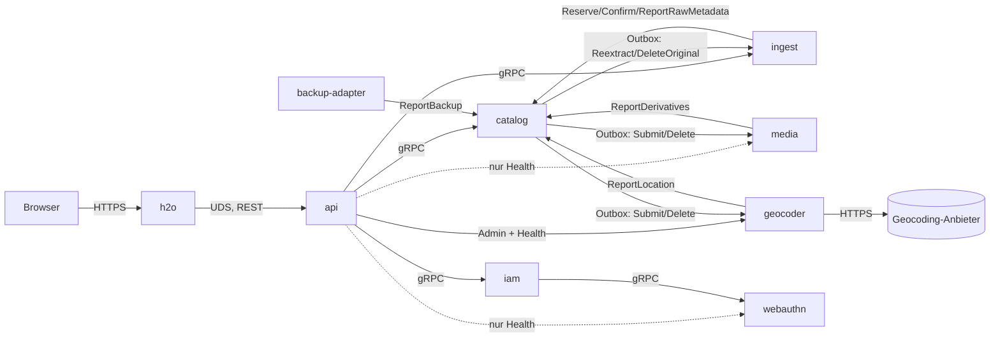
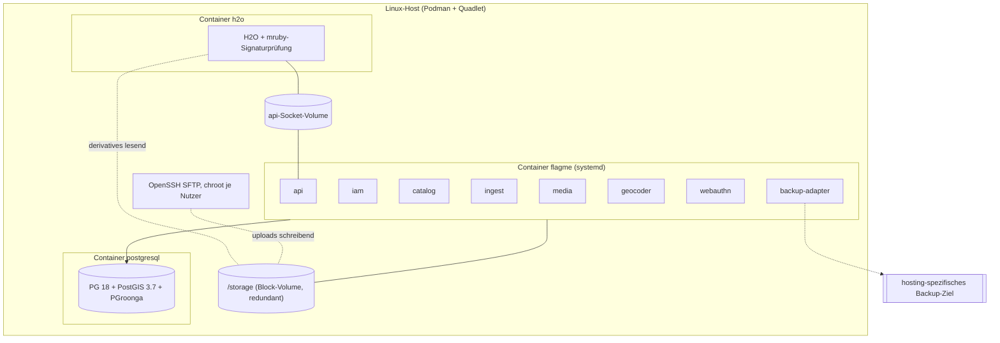
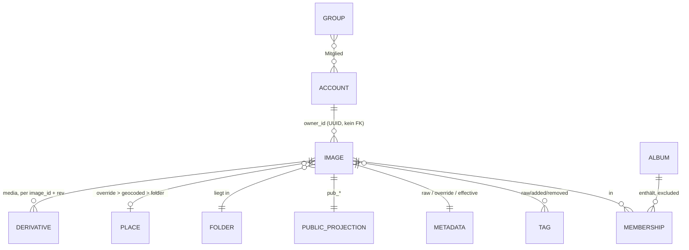

# Architecture Spine — FlagMe - The Geo Gallery

## Design Paradigm

**Microservices auf einem Host mit BFF und Database-per-Service (Schema-Variante).**

- **Edge** (`h2o`-Container): TLS, HTTP/2/3, statisches Angular, Ableitungen per signierter URL, Wartungsseite, Reverse Proxy zur api.
- **BFF** (`api`): REST/JSON + FlatBuffers zum Frontend, Session → Principal, CSRF, Rate Limit, Audit. Besitzt keine Fachdaten.
- **Fachliche Services** (`iam`, `catalog`, `ingest`, `media`, `geocoder`, `webauthn`) und der hosting-spezifische `backup-adapter`: jeder besitzt seine Daten; Zusammenarbeit nur über gRPC-Verträge und eigene Job-Queues.
- **Daten** (`postgresql`-Container): ein Schema + Rollen pro Service.

## Invariants & Rules



Pfeil = „darf aufrufen“, gestrichelt = nur gRPC Health. Kein anderer Aufrufweg ist erlaubt; AD-9 und AD-38 setzen genau diesen Graphen durch.

### AD-1 — Service-Schnitt und Datenbesitz [ADOPTED]

- **Binds:** all
- **Prevents:** Fachlogik in der api; neue Services oder Tabellen ohne geklärten Besitzer.
- **Rule:** V1 hat genau diese Komponenten und Besitzer:

| Service | Besitzt |
| --- | --- |
| api | kein Fachschema; Schema `audit` (AD-35) |
| iam | Konten, Status, Rollen, Berechtigungen, Gruppen, Passkey-Credentials, Challenges, TOTP, Sessions, Upload-Zuordnung `upload_dir → user_id` |
| catalog | Bilder, SHA256-Register, Metadaten (raw/override/effective), Orte, Ordnerbaum, Alben, Tags, Bewertung, Sichtbarkeit und öffentliche Projektion, Papierkorb, Prüfliste, Sicherungsstatus, Privacy-Ledger, Katalog-Einstellungen (Positivliste R7, Copyright-Default R31), Outbox |
| ingest | Upload-Eingang, Import-Jobs, Duplikat-Parkplatz, einzige Metadaten-Extraktion aus Dateien |
| media | Ableitungs-Jobs und Ableitungsregister |
| geocoder | Geocoding-Jobs, Cache, Provider-Konfiguration (Reihenfolge, Limits, verschlüsselte API-Keys), Kontingentzähler (AD-50) |
| webauthn | nichts (zustandslos, AD-24) |
| backup-adapter | nichts im Cluster; hosting-spezifisch (AD-27) |

Keine eigenen Services für public, admin/monitoring oder audit: öffentliche Galerie = catalog mit anonymem Principal; Monitoring aggregiert die api aus gRPC Health, OTel und inhaltsfreien Views (AD-44).

### AD-2 — Nur catalog schreibt Bilddaten; Importlebenszyklus

- **Binds:** epic-import-pipeline, epic-ort-karte, epic-pflege, epic-alben-sichtbarkeit, epic-datensicherheit-betrieb
- **Prevents:** Zwei Schreibpfade auf Bildzeilen; Duplikate bei parallelen Importen; zwei Metadaten-Extraktoren; Geister-Reservierungen.
- **Rule:**
  - Nur catalog legt Bilder an oder ändert sie; catalog ist Autorität für die SHA256-Eindeutigkeit (Unique-Constraint).
  - `Reserve(sha256, ingest_job_id, owner_id, anfangsgrenze)` → `ACCEPTED` | `DUPLICATE(image_id)`. Gleicher sha256 mit anderer `ingest_job_id` = `DUPLICATE` → ingest parkt (R12).
  - Nur nach `ACCEPTED` verschiebt ingest nach `originals/`, dann `Confirm(image_id, path, RawMetadata)`.
  - Bildzeilen haben `state = reserved | active`; nur `active` ist lesbar (AD-20). Reservierungen ohne `Confirm` verfallen nach Frist.
  - Endgültiges Löschen gibt den sha256 frei.
  - ingest ist der einzige Extraktor (Exiv2). Reindex bestellt catalog per Outbox `Reextract` bei ingest; Antwort `ReportRawMetadata`.

### AD-3 — Ein Schema und eigene Rollen pro Service [ADOPTED]

- **Binds:** all
- **Prevents:** Ein Service ändert fremde Tabellen direkt.
- **Rule:** Gemeinsamer PostgreSQL-Cluster; jeder Service hat ein eigenes Schema. Eine Owner-Rolle fährt nur Migrationen; die Laufzeitrolle ist nicht Eigentümerin der Tabellen und schreibt nur ins eigene Schema. Fremdzugriff nur lesend auf ausdrücklich veröffentlichte Views (`security_invoker = true`) oder per gRPC.

### AD-4 — UUIDv7 für alle grenzüberschreitenden IDs [ADOPTED]

- **Binds:** all
- **Prevents:** bigint/uuid-Mischung zwischen Services und Epics.
- **Rule:** Jede ID, die eine Service-Grenze, die API oder das Frontend erreicht, ist eine UUIDv7, erzeugt per `uuidv7()` in PostgreSQL.

### AD-5 — Keine Fremdschlüssel über Schemagrenzen [ADOPTED]

- **Binds:** all, besonders R26
- **Prevents:** Gekoppelte Schemata; verwaiste Ableitungen, Cache-Einträge und Jobs.
- **Rule:** Referenzen auf fremde Entitäten sind nackte UUIDs ohne FK. Endgültiges Löschen propagiert catalog per Outbox an ingest (`DeleteOriginal`, sha256-geprüft), media und geocoder; jeder entfernt auch Jobs und Cache-Einträge zum Bild.

### AD-6 — Metadaten, Orte und Tags in Ebenen [ADOPTED]

- **Binds:** R14, R15, R16, R17, R18, R22, R23, R27, R31
- **Prevents:** Reindex überschreibt Bearbeitungen; Epics mit unterschiedlicher Vorrangregel; doppelte Orte.
- **Rule:**
  - Felder: `raw` (nur Reindex ersetzt), `override` (Reindex fasst nie an), `effective` (override vor raw). Anzeige, Filter, Suche, Copyright und öffentliche Projektion lesen nur `effective`.
  - Ort: `override > geocoded > folder (ungefähr)`; `geocoded` gehört dem Ortsmodell, nicht `raw`. Orte haben einen kanonischen Schlüssel (ISO 3166 für Land/Provinz, anbieterunabhängige ID darunter) und Anzeigenamen je Sprache; Ordnernamen werden vor dem Vergleich (R18) auf ihn abgebildet. Geo-Validierung und Prüfliste macht catalog.
  - Tags: `raw` (aus Keywords), `added`, `removed`; effektiv = (raw − removed) ∪ added.

### AD-7 — Aufnahmezeit als Ortszeit [ADOPTED]

- **Binds:** R10, R22, R27
- **Prevents:** Zeitzonenverschiebung zwischen Dateiname, Filter und Anzeige.
- **Rule:** Aufnahmezeit = `timestamp without time zone` wie im EXIF, plus Offset falls bekannt, plus `zeit_unsicher`. Ohne Aufnahmezeit dient die Dateizeit nur dem Dateinamen; die effektive Aufnahmezeit bleibt leer bis zur Korrektur. Systemzeiten sind `timestamptz` UTC.

### AD-8 — Nur die api kennt Sessions; Principal ist Pflichtfeld [ADOPTED]

- **Binds:** R1, R3, R4, R29
- **Prevents:** Vergessene oder doppelte Session-Prüfung.
- **Rule:** Nur api löst eine Session (über iam) zu einem `Principal` (user_id, group_ids, permissions | anonym) auf. Jede RPC, bei der Sichtbarkeit oder Rechte zählen, trägt `Principal` als Pflichtfeld der Request-Message. Services prüfen keine Sessions.

### AD-9 — Aufrufrechte über Socket-Dateirechte [ADOPTED]

- **Binds:** all
- **Prevents:** Prozesse außerhalb des Graphen erreichen einen Service.
- **Rule:** Jeder Service läuft unter eigenem Unix-User; `/run/flagme/<service>.sock` ist nur für die Gruppen der im Graphen erlaubten Aufrufer zugänglich.

### AD-10 — Rechteprüfung beim Datenbesitzer

- **Binds:** R3, R5, R26, R29
- **Prevents:** api und Service prüfen dieselbe Berechtigung unterschiedlich.
- **Rule:** Der Service, der die Daten besitzt, prüft RBAC-Berechtigung und Besitzregeln (R29) anhand des Principal. api prüft nur Authentisierung, CSRF und Rate Limit. Berechtigungsnamen stehen als geschlossene Liste in `contracts/permissions/`, Besitzer iam.

### AD-11 — gRPC-Fehler und Deadlines [ADOPTED]

- **Binds:** all
- **Prevents:** Hängende Requests; uneinheitliche Fehlerabbildung.
- **Rule:** Services liefern Standard-gRPC-Statuscodes; nur api übersetzt in HTTP und den Envelope (AD-29); gRPC-Details werden nie nach außen gereicht. api setzt pro Request eine Deadline aus dem Leistungsbudget; jeder Service gibt sie weiter.

### AD-12 — Ableitungen nur über signierte, ablaufende URLs [ADOPTED]

- **Binds:** R4, R5, R6, R21, R26, R30
- **Prevents:** Ungeprüfte Auslieferung; Entzug wirkt nie; Caches halten private Ableitungen.
- **Rule:**
  - catalog signiert nur Zeilen, die AD-20 passiert haben: HMAC-SHA256 über den vollen Pfad (inkl. Größe und `derivative_rev`) und `exp`; `exp` auf ein festes Fenster gerundet (Default 1 h).
  - h2o prüft die Signatur lokal (mruby, konstantzeitiger Vergleich) über den vollen Pfad und reicht per `reproxy` an die Dateiauslieferung; ohne gültige Signatur 404. Kein anderes Mapping auf `/storage/derivatives`.
  - `Cache-Control: private, max-age=<Restlaufzeit>`; nur Bilder mit `vis_public` dürfen `public` tragen. Kein geteilter Cache/CDN in V1.
  - Papierkorb, Zurücknehmen, Einengung auf nicht-public und endgültiges Löschen erhöhen `derivative_rev` (media benennt um), damit alte URLs sofort 404 liefern. Weitergabe einer URL durch Angemeldete bis Ablauf ist akzeptiert.
  - Der HMAC-Schlüssel ist ein Podman-Secret in `flagme` und `h2o`. Originale werden nie ausgeliefert.

### AD-13 — Storage-Layout und Schreibrechte [ADOPTED]

- **Binds:** R6, R9, R10, R11, R12, R24, R26
- **Prevents:** Pfade ändern sich mit Ordnern; zwei Worker vergeben denselben Namen; späte Jobs überschreiben neuere Ableitungen; halbe Uploads werden importiert.
- **Rule:**
  - `uploads/<username>/`: Web-Uploads schreibt ingest; per SFTP schreibt nur der chroot-SFTP-Account dieses Nutzers. Fertig ist eine Datei erst nach Umbenennen von `*.part` bzw. nach einer Ruhefrist. Verschieben und Löschen nur durch ingest.
  - `parked/`: nur ingest.
  - `originals/`: ingest schreibt jedes Original genau einmal per `renameat2(RENAME_NOREPLACE)` (Kollision → hochzählen), danach `0440`. Entfernen nur per `DeleteOriginal` von catalog.
  - `derivatives/<2>/<2>/<image_id>_<derivative_rev>_<größe>.avif`: nur media; schreibt temporär und benennt nur um, wenn `derivative_rev` ≥ Registerstand; ältere Revisionen werden nach Quittung gelöscht. h2o liest nur hier.
  - `uploads/` und `originals/` auf demselben Dateisystem; `/storage` ist ein lokal eingehängtes Block-Volume auf redundantem Speicher, keine Netzfreigabe.

### AD-14 — Jeder Service besitzt seine Job-Queue [ADOPTED]

- **Binds:** R13, R17, R23
- **Prevents:** Gemeinsame Queue-Tabelle ohne Besitzer.
- **Rule:** Queues liegen im Schema ihres Service; nur der Besitzer schreibt. Arbeit bei einem anderen Service wird per gRPC an dessen Besitzer bestellt.

### AD-15 — Übergaben at-least-once, Empfänger idempotent [ADOPTED]

- **Binds:** R13, R17, R23, R26, R31
- **Prevents:** Verlorene Aufträge; doppelte Verarbeitung; veraltete Ergebnisse überschreiben neue; Worker lesen Katalogtabellen.
- **Rule:**
  - Der Sender hält Job oder Outbox-Eintrag bis zur Quittung. catalog schreibt Aufträge in derselben Transaktion wie die Bildänderung in seine Outbox; ein Relay liefert aus.
  - Getrennte Revisionen je Bild: `derivative_rev` (effektives Copyright, Orientierung, Reindex, Entzug), `geo_rev` (Koordinaten), `meta_rev` (Reextraktion). Empfänger sind idempotent über `image_id`+Revision (beim Import `sha256`+`ingest_job_id`); catalog verwirft Reports mit veralteter Revision.
  - Aufträge tragen alle Eingaben (Pfad, Copyright, Koordinaten, Revision); media und geocoder lesen nie Katalogtabellen.

### AD-16 — Einheitliche Job-Form als DB-Vertrag [ADOPTED]

- **Binds:** R13, R23
- **Prevents:** Pro Service eigener Job-Dialekt.
- **Rule:** Jede Queue hat die Zustände `queued | running | retry_wait | succeeded | failed`, Versuchszähler, Fehlercode, Backoff und Priorität und veröffentlicht eine View in der Form aus `contracts/jobs/`. Holen per `FOR UPDATE SKIP LOCKED`, Wecken per `LISTEN/NOTIFY`. Die C++-Bibliothek ist nur eine Implementierung.

### AD-17 — Import-Priorität im Betriebssystem [ADOPTED]

- **Binds:** Leistungsziele „auch während Import“
- **Prevents:** Priorisierungslogik in jeder Queue.
- **Rule:** ingest und media laufen mit niedrigerem `CPUWeight`/`IOWeight`/`Nice` als api und catalog. Worker-Zahl ist Konfiguration pro Hardware-Profil (AD-22).

### AD-18 — Sichtbarkeitsregel [ADOPTED]

- **Binds:** R4, R5, R26, R29, R30
- **Prevents:** Unterschiedliche Auslegung von „restriktivste gewinnt“ in drei Epics.
- **Rule:**
  - Eigene Bildeinstellung = Obergrenze; Default „keine eigene Grenze“. Nur der Owner engt per Obergrenze ein.
  - Basis jedes Bildes: alle angemeldeten. Alben können nur erweitern (bis zur Obergrenze), nie unter die Basis einengen; über mehrere Alben gilt die weiteste Albumeinstellung. Effektiv = enger von (Obergrenze, weiter von (Basis, weitestes Album)).
  - Zurücknehmen (R30) senkt die eigene Obergrenze dauerhaft auf „alle angemeldeten“, bis der Owner sie wieder anhebt; Ausschlüsse ersetzen das nicht.
  - Gruppen: über Alben vereinigt, mit der Obergrenze geschnitten.
  - Ausschluss pro public-Album wirkt nur auf dessen public-Weg (AD-41).
  - Owner sieht eigene Bilder immer. Für Admins gibt es genau eine zweite Policy `admin_manage`: nicht-private Zeilen, nur für Verwaltungs-RPCs (R29), nie für Raster, Suche oder Karte. Privat bleibt für Admins unsichtbar.
  - Papierkorb blendet überall aus; die Papierkorbansicht ist eine eigene Policy (Zeilen, die der Principal ohne `trashed` sehen dürfte und für die er `image.delete` hat), kein Flag am allgemeinen List-RPC.

### AD-19 — Fremde Bilder in eigenen Alben [ADOPTED]

- **Binds:** R5, R29
- **Prevents:** Veröffentlichung fremder Bilder am Owner vorbei.
- **Rule:** Ein Album öffnet einem fremden Bild höchstens dessen Obergrenze. Ohne eigene Grenze des Owners ≥ public macht kein Fremder ein Bild öffentlich. „Privat“ an einem Album heißt: nur der Album-Owner sieht das Album.

### AD-20 — Sichtbarkeitsfilter einmal, materialisiert, per RLS [ADOPTED]

- **Binds:** R4, R5, R19, R20, R21, R22
- **Prevents:** Zweiter Filter in einem Epic; Albumlogik pro Abfrage sprengt die Leistungsziele.
- **Rule:** Jede Bildzeile trägt materialisierte Publikumsspalten (`owner_id`, `vis_authenticated`, `vis_public`, `vis_group_ids[]` mit GIN, `trashed`, `state`), gepflegt nach AD-42. Durchsetzung per Row-Level Security nach AD-39; catalog setzt den Principal je Transaktion. Der anonyme Principal liest nur die öffentliche Projektion (AD-40).

### AD-21 — Ein gemeinsamer Testbestand [ADOPTED]

- **Binds:** Leistungsziele, „Done when“
- **Prevents:** Jedes Epic misst mit eigenen Daten.
- **Rule:** Der Generator gehört epic-import-pipeline, mit festem Seed. Er erzeugt 1 Mio. Bilder über `Reserve`/`Confirm` (nie per SQL vorbei), mit GPS-Clustern, ~15 % ohne GPS, gemischten Albengrößen und Sichtbarkeiten inkl. Gruppen, privat und ausgeschlossen. Bilder ohne Pixel zeigen auf ein gemeinsames Platzhalter-Original und tragen `synthetic`. Gemessen wird immer mit parallel laufendem Import.

### AD-22 — Hardware-Profile; Architektur identisch [ADOPTED]

- **Binds:** all, Leistungsziele
- **Prevents:** Ein „Sparmodus“ im Code; Leistungszahlen ohne Bezugsprofil.
- **Rule:** Profile unterscheiden sich nur in Konfiguration (Worker-Zahl, PG-Speicher, Prioritäten). Leistungsziele und Durchsatz gelten pro Profil; M ist Referenz für „Done when“, S ist offiziell unterstützter Einstieg. Zahlen sind Schätzungen bis zum Benchmark in epic-import-pipeline.

| Profil | Hardware | Lesepfad bei 1 Mio. | Import | Einschränkung |
| --- | --- | --- | --- | --- |
| **M (Referenz)** | 8C/16T, 32 GB, NVMe ≥ 1 TB, Originale ≥ 8 TB gespiegelt | alle Ziele, auch während Import | ≥ 10.000/h | – |
| **S (Einstieg)** | 4 Kerne, 8 GB | Ziele ohne laufenden Import plausibel | ~3.000–4.000/h, 1–2 media-Worker | Erstimport 200.000 ≈ 2–3 Tage; während Import können p95-Ziele reißen |
| **XS** | 4 Kerne, 4 GB | nur bis ~200–300 Tsd. Bilder | ~2.000–3.000/h, 1 media-Worker | Swap-Gefahr bei großen HEIC/TIFF; für 1 Mio. nicht empfohlen |

### AD-23 — Sprachneutrale Verträge [ADOPTED]

- **Binds:** all
- **Prevents:** Ein Rust- oder Go-Service baut an den gemeinsamen Konventionen vorbei.
- **Rule:** Eine Komponente darf C++23, Rust oder Go sein, wenn sie erfüllt: gRPC/Protobuf aus `contracts/proto/` über UDS; systemd-Unit mit Socket Activation und gRPC Health; eigenes Schema und Rollen; Job-Form nach AD-16; Methodenrechte nach AD-38; JSON-Logs und OTel nach den Conventions; Geheimnisse nach AD-26.

### AD-24 — WebAuthn-Prüfung zustandslos in Rust [ADOPTED]

- **Binds:** R2
- **Prevents:** Sicherheitskritischer Eigenbau; zweiter Besitzer von Credentials.
- **Rule:** `webauthn` (Rust, webauthn-rs) prüft Registrierung und Assertion und liefert nur das Ergebnis. Credentials und Challenges besitzt iam und übergibt sie je Aufruf. Attestation „none“ genügt.

### AD-25 — Laufzeit: drei Podman-Container [ADOPTED]

- **Binds:** all, Betrieb
- **Prevents:** Abweichende Deployment-Formen je Epic.
- **Rule:** Podman mit Quadlets; Container `h2o`, `flagme`, `postgresql`, jeder als systemd-Unit auf dem Host. Im `flagme`-Container läuft systemd als Init mit einer Unit, einem Unix-User und einem Socket je Service. Gemeinsame Volumes: api-Socket zwischen h2o und flagme; `/storage/derivatives` in h2o nur lesend; `/storage` gesamt in flagme; `uploads/` zusätzlich für den SFTP-Dienst des Hosts. Normale Updates tauschen einzelne Services im laufenden `flagme`-Container (`systemctl restart`, Socket Activation puffert Anfragen); ein neues Image nur für Basis-Updates, mit der Wartungsseite (R25) als geplantem Verhalten.

### AD-26 — Geheimnisse [ADOPTED]

- **Binds:** all
- **Prevents:** Geheimnisse in Klartext-Konfiguration oder im Repo.
- **Rule:** DB-Passwörter liegen in einer mit XChaCha20-Poly1305 (libsodium) verschlüsselten Datei im Volume; Geocoding-API-Keys liegen ebenso verschlüsselt im Schema `geocoder` (AD-50). Drei Podman-Secrets: `config-key` (Konfig-Datei), `geocoder-key` (API-Keys) und `url-hmac-key` (AD-12). Jeder Chiffretext trägt `key_id` und ist an Tabelle und Zeilen-ID gebunden (AAD); alte Schlüssel bleiben über das PITR-Fenster gesichert. Neustart ohne Passworteingabe. Schlüssel werden getrennt vom Host gesichert, damit ein Restore auf leerem Host möglich ist.

### AD-27 — Backup-Vertrag [ADOPTED]

- **Binds:** R24, R26
- **Prevents:** Jedes Hosting interpretiert RPO 0 anders; ungesicherte Originale bleiben unbemerkt.
- **Rule:**
  - Der `backup-adapter` ist eine eigene Unit mit eigenem Unix-User und ruft nur `catalog.ReportBackup`. catalog führt je Original „gesichert bis T“; die Admin-Ansicht warnt bei ungesicherten Originalen. Ob der Import auf die Sicherung wartet, ist Einstellung des Hosting-Profils.
  - Pflichten jedes Adapters: Originale, DB mit PITR (WAL-Archiv), Privacy-Ledger (AD-45) und Podman-Secrets sichern; Aufbewahrung nach endgültigem Löschen 90 Tage; dokumentierter, getesteter Restore auf leeren Host mit SHA256-Prüfung aller Originale.
  - „Restore fertig“ (≤ 24 h) = DB + Originale + Privacy-Ledger. Ableitungen werden nicht gesichert, sondern danach im Hintergrund neu erzeugt; bis dahin zeigen Raster und Galerie Platzhalter.

### AD-28 — Migrationen nur Expand/Contract

- **Binds:** all
- **Prevents:** Ausfall beim Neustart einzelner Services mit gemischten Versionen.
- **Rule:** Schemaänderungen erst additiv, dann umstellen, Altes erst in einem späteren Release entfernen. Proto- und `.fbs`-Änderungen innerhalb einer Version nur additiv (AD-34).

### AD-29 — REST-API mit einheitlichem Envelope [ADOPTED]

- **Binds:** alle Frontend-Epics
- **Prevents:** Frontend und Backend driften in Pfaden, Feldern und Fehlern auseinander; Existenz-Orakel.
- **Rule:** Versioniert unter `/api/v1` mit HTTP-Verben. Jede JSON-Antwort ist der Envelope `{id, status, code, title, detail, meta, data}`; `id` = `X-Request-ID` (gültige UUID vom Client wird übernommen). `meta` trägt `timestamp` (UTC, RFC 3339), `version`, bei Sammlungen `count`, dazu `limit`/`offset` oder `nextCursor` (AD-31). `code` stammt aus einer geschlossenen Registry im OpenAPI-3.1-Vertrag der api; 500 nur mit generischem Text. Nicht sichtbar und nicht vorhanden liefern identisch 404. JSON-Felder `camelCase`; der TypeScript-Client wird aus OpenAPI generiert.

### AD-30 — FlatBuffers nur zwischen api und Frontend [ADOPTED]

- **Binds:** R19, R20, R21, R22
- **Prevents:** Zwei Datenformen für dieselbe Ressource; FlatBuffers wandern nach innen; verborgene Felder erscheinen als Default-Werte.
- **Rule:** Bilddaten liefert die api bei `Accept: application/x-flatbuffers` binär, sonst als JSON mit denselben Feldern. Fehler immer im JSON-Envelope. Das `.fbs`-Schema ist Vertrag der api. Felder außerhalb der Sicht des Principal fehlen (optionale Skalare, fehlende Tabellen; im JSON fehlt der Schlüssel). Intern keine FlatBuffers.

### AD-31 — Cursor-Pagination für Bildsammlungen [ADOPTED]

- **Binds:** R20, R21, R22
- **Prevents:** Langsames `OFFSET` bei 1 Mio.; doppelte oder fehlende Bilder während Import; Cursor verraten verborgene Werte.
- **Rule:** Raster, Suche und Kartenlisten paginieren nur per Cursor (Sortierschlüssel + UUID) mit `meta.nextCursor`. Cursor sind für den Client opak (von der api authentifiziert verschlüsselt). Andere Sammlungen dürfen `limit`/`offset` nutzen.

### AD-32 — Volltextsuche nur über PGroonga [ADOPTED]

- **Binds:** R22
- **Prevents:** Sprachweichen und mehrere Suchmechanismen; Suche als Orakel für verborgene Felder.
- **Rule:** Eine PGroonga-indizierte Suchspalte über die effektiven Felder (Titel, Beschreibung, Keywords, Kamera, Objektiv) für alle Schriften. Für den anonymen Principal gilt nur `pub_search` (AD-40). Filter laufen über typisierte effektive Spalten.

### AD-33 — Kartencluster über vorberechneten Kachelschlüssel

- **Binds:** R8, R20
- **Prevents:** Live-Clustering, das bei 1 Mio. die 300 ms sprengt; öffentliche Cluster verraten exakte Orte.
- **Rule:** catalog speichert je Ort einen Quadkey bis Zoom ~18; Cluster = Gruppierung über das Präfix der Zoomstufe, unter RLS. Radius-, Polygon- und BBox-Suche über PostGIS `GEOGRAPHY(Point,4326)` mit GiST-Index. Für den anonymen Principal nur über `pub_quadkey`/`pub_point` (AD-40).

### AD-34 — Verträge im Haupt-Repo [ADOPTED]

- **Binds:** all
- **Prevents:** Jedes Service-Repo hält eine eigene Kopie der Verträge.
- **Rule:** Das Haupt-Repo `flag-me_gallery` hält Doku, Architektur und `contracts/` (`proto/flagme/<service>/v1/` mit `access.yaml`, `fbs/`, `openapi/`, `jobs/`, `permissions/`). Paket `flagme.<service>.v1`; brechende Änderungen nur als `v2` daneben, `buf breaking` in CI. Service-Repos, gemeinsame Bibliotheken und das Web-Frontend sind eigene Repos namens `flagme-<name>` (z. B. `flagme-api`, `flagme-service-core`, `flagme-web`), lokal als vom Haupt-Repo ignorierte Ordner, und binden Verträge über einen festen Git-Tag.

### AD-35 — Audit gehört der api [ADOPTED]

- **Binds:** Sicherheit (Audit Logging)
- **Prevents:** Zwei Audit-Mechanismen.
- **Rule:** Audit läuft als api-Plugin (Basis `drogon_audit_plugin`, ohne FK auf `users`) in das Schema `audit`, Besitzer api; Inhalt nach AD-44.

### AD-36 — Toolchain und Wiederverwendung [ADOPTED]

- **Binds:** all C++-Komponenten
- **Prevents:** Gemischte Sprachstandards; Übernahme verworfener Snippet-Teile; Metadaten in Ableitungen.
- **Rule:**
  - C++23 (auch für `drogon_auth`, das auf C++26 steht), Conan 2, CMake-Presets; Abhängigkeiten, die ConanCenter zu alt führt, über eigene Rezepte. gRPC mit `with_libsystemd=True`.
  - Snippets: `drogon_auth` → Basis iam (ohne Passwort-Login und SQLite); `drogon_audit_plugin` → api; `geocoding` → Bibliothek in geocoder, umgebaut auf DB-Kontingente, Sekundentakt, typisierte Fehler mit `retry_after` und Keys ohne Klartext in URLs/Logs (AD-50, AD-51); `photo_indexer` → Exiv2-Extraktion in ingest und Benchmark (ohne FlatBuffers); `img2avif` und `web-gallery_backend_h2o-drogon` → nur Referenz; `rz-gallery_*`, `crow_*`, `qt_*`, `web-gallery_worker` → nicht.
  - media erzeugt AVIF über libvips `heifsave` (libheif); es speichert ohne Metadaten (EXIF-Orientierung vorher angewendet, nur ICC zulässig) und schreibt danach nur das Copyright-Feld; ein CI-Test prüft jede Größe aller sechs Eingabeformate.

### AD-37 — PostgreSQL 18 als Startversion [ADOPTED]

- **Binds:** all
- **Prevents:** Code hängt an einer PG-Hauptversion, für die Erweiterungen fehlen.
- **Rule:** Start mit PostgreSQL 18 + PostGIS 3.7 + PGroonga. Die Hauptversion ist Eigenschaft des `postgresql`-Containers; Code nutzt keine Funktionen, die es in PG 18 nicht gibt. Major-Upgrades sind Betrieb.

### AD-38 — Methodenrechte per Peer-Credential

- **Binds:** all
- **Prevents:** Ein kompromittierter media- oder ingest-Prozess ruft catalog mit gefälschtem Principal auf.
- **Rule:** Jeder Service liest pro Verbindung `SO_PEERCRED` und prüft jede Methode gegen die Allow-Liste in `access.yaml` (AD-34). Ein Principal wird nur von der uid der api angenommen. Service-Aufrufe (`Reserve`, `Confirm`, `Report*`) tragen keinen Principal, sondern die Service-Identität aus der uid.

### AD-39 — RLS-Härtung

- **Binds:** R4, R5, R29
- **Prevents:** RLS greift nicht (Tabellen-Owner, Views, fehlender Principal, Pflege-Bypass).
- **Rule:** catalog hat `catalog_owner` (nur Migrationen), `catalog_app` (`NOBYPASSRLS`, nicht Owner), `catalog_maint` (Pflege der Publikumsspalten, eigener Pool, nie für Leseantworten). Alle Bild-, Mitgliedschafts- und Album-Tabellen haben `ENABLE` und `FORCE ROW LEVEL SECURITY`. Policies scheitern geschlossen: fehlt `gg.principal`, sieht die Abfrage nichts. Jede Leseabfrage läuft in einer expliziten Transaktion mit `set_config(..., true)`. CI-Test: Abfrage ohne Principal liefert 0 Zeilen.

### AD-40 — Öffentliche Projektion materialisiert

- **Binds:** R5, R7, R8, R20, R22
- **Prevents:** Öffentliche Karte, Suche, Filter und Sortierung lesen verborgene Felder oder exakte Koordinaten.
- **Rule:** catalog pflegt je Bild `pub_fields` (Positivliste, Schnittmenge über die public-Alben, in denen das Bild nicht ausgeschlossen ist), `pub_gps_mode` (aus vor vergröbert vor exakt), `pub_point` (exakt, auf das Vergröberungsraster gerundet oder NULL), `pub_quadkey` (aus `pub_point`, bei „vergröbert“ gekürzt), `pub_search` (PGroonga nur über Felder in `pub_fields`) und Ortsfelder nur, wenn in `pub_fields`. Der anonyme Principal clustert, sucht, filtert und sortiert ausschließlich über diese Spalten; exakte Spalten sind für ihn nicht lesbar. Anonyme Filter auf andere Felder → `VALIDATION_FAILED`. Das Copyright der Ableitung (R31) ist immer öffentlich, steht außerhalb der Positivliste und wird beim Veröffentlichen (R30) angezeigt.

### AD-41 — Albumkontext

- **Binds:** R5, R28
- **Prevents:** Ein in Album A ausgeschlossenes, über Album B öffentliches Bild erscheint in A.
- **Rule:** Jede Abfrage im Kontext eines Albums filtert zusätzlich über die Mitgliedschaftszeile; für den anonymen Principal `excluded = false AND album.public`. Für andere Principals gilt die Albumsicht nur, wenn das Album selbst für sie sichtbar ist.

### AD-42 — Neuberechnung der Sichtbarkeit

- **Binds:** R4, R5, R26, R30
- **Prevents:** Verlorene Updates bei parallelen Änderungen; Einengungen wirken verspätet.
- **Rule:** Publikums- und Projektionsspalten (AD-20, AD-40) werden aus dem Gesamtzustand des Bildes neu berechnet, nie inkrementell, unter Zeilensperre (`FOR UPDATE`, sortiert nach `image_id`) in der Transaktion der auslösenden Änderung. Einengungen (Unpublish, Ausschluss, Zurücknehmen, Grenze senken, Papierkorb, Gruppe entfernen) sind synchron; nur Erweiterungen dürfen nachlaufen. Große Einengungen setzen zuerst das Album-Gate (`album.public = false`) und rechnen dann in Batches. Ein Prüfjob vergleicht regelmäßig materialisiert mit neu berechnet.

### AD-43 — Jeder Lesepfad hat ein Publikum

- **Binds:** R16, R19, R20, R21, R22
- **Prevents:** Ordner-, Orts-, Tag- und Albumlisten, Zähler oder Cover verraten private Inhalte.
- **Rule:** Ordner, Orte, Tags und Alben erscheinen einem Principal nur, wenn mindestens ein für ihn sichtbares Bild sie trägt (Alben zusätzlich nach eigener Sichtbarkeit). Zähler, Facetten, Cover, Cluster und `meta.count` werden unter RLS des anfragenden Principal berechnet oder aus Aggregaten je Publikum, die AD-42 mitpflegt. Globale Zähler sind verboten. Ein Cover ist immer ein für den Principal sichtbares Bild.

### AD-44 — Betriebsdaten sind inhaltsfrei

- **Binds:** R12, R18, R23, R29
- **Prevents:** Admin- und Betriebsansichten zeigen private Inhalte.
- **Rule:** Job-Views, Outbox, Audit, Logs und Fehlerfelder enthalten nur IDs, Codes und Zähler: keine Pfade unterhalb von `originals/`, keine Koordinaten, keine Metadatenwerte; Fehlertexte stammen aus einer geschlossenen Code-Liste. Admin-Ansichten (Prüfliste, Duplikate, Jobs) lösen Bilddetails über catalog unter dem Principal des Betrachters auf; nicht sichtbare Bilder erscheinen als „privates Bild“ mit ID. Erledigte Jobs und quittierte Outbox-Einträge werden nach Frist gelöscht, bei endgültigem Löschen sofort.

### AD-45 — Restore wahrt Einengungen

- **Binds:** R24, R26, R30
- **Prevents:** Ein PITR-Restore macht Zurückgenommenes wieder öffentlich oder bringt Gelöschtes zurück.
- **Rule:** catalog schreibt jede Einengung und jedes endgültige Löschen zusätzlich in ein append-only Privacy-Ledger, das wie Originale gesichert wird. Nach einem Restore bleibt die öffentliche Galerie auf der Wartungsseite (R25), bis das Ledger ab Restore-Zeitpunkt erneut angewendet ist. Ein Abgleich `originals/` ↔ SHA256-Register importiert verwaiste Originale über ingest neu.

### AD-46 — Upload-Herkunft

- **Binds:** R9, R10
- **Prevents:** Bilder landen per Pfad oder Symlink beim falschen Owner oder lesen Host-Dateien.
- **Rule:** Der Owner eines Imports stammt aus dem Principal des Web-Uploads bzw. aus der Zuordnung `upload_dir → user_id` von iam, nie aus dem Verzeichnisnamen allein. Pfade werden mit `openat2(RESOLVE_BENEATH | RESOLVE_NO_SYMLINKS)` geöffnet; `..`, absolute Pfade und Symlinks werden abgelehnt. Web-Uploads laufen h2o → api → ingest als Stream; höchstens 10 gleichzeitig.

### AD-47 — Edge- und Session-Sicherheit

- **Binds:** R1, R2, Sicherheits-Constraints
- **Prevents:** Jedes Epic setzt Header, Cookies und Limits anders.
- **Rule:** Nur TLS 1.3 an der Edge. Sessions sind serverseitig (iam) mit Cookie `Secure; HttpOnly; SameSite=Strict`; kein JWT. CSRF-Token für alle zustandsändernden Requests. CSP ohne `unsafe-inline`/`unsafe-eval`, Quellen nur eigene Origin und die Kartenkachel-Quelle. Rate Limit pro Session und IP in der api. Audit-Mindestereignisse: An-/Abmeldung, Kontoänderungen, Rollen-/Gruppenänderungen, Veröffentlichen/Zurücknehmen, Sichtbarkeitsänderungen fremder Inhalte, endgültiges Löschen, Reindex, Änderungen der Geocoder-Konfiguration. Eine Deaktivierung (R1) wirkt spätestens nach 60 s.

### AD-48 — Umgebungen, CI und Release-Manifest

- **Binds:** all, epic-plattform-zugang
- **Prevents:** Ein Container-Image aus zufälligen Ständen getrennter Repos; Umgebungen mit abweichendem Aufbau.
- **Rule:** Umgebungen `dev`, `bench` (Hardware-Profil, Testbestand) und `prod` sind gleich aufgebaut und unterscheiden sich nur in Konfiguration und Profil. Jedes Repo hat CI mit Build, Tests und (für Verträge) `buf breaking`. Ein Release-Manifest im Haupt-Repo pinnt je Release den Tag jedes Service-Repos, der Verträge und des Web-Builds; nur aus ihm wird das `flagme`-Image gebaut.

### AD-49 — Ein Vertrag für alle Frontends [ADOPTED]

- **Binds:** alle Frontend-Epics, künftige Clients
- **Prevents:** Clientspezifische Endpunkte oder Datenformen; Web und Desktop driften auseinander.
- **Rule:** Web-Frontend ist Angular 22 mit Spartan/UI. Das bestehende Desktop-Frontend (C++23/Qt 6.10+) und künftige Clients nutzen dieselben Verträge `/api/v1` (OpenAPI + `.fbs`); es gibt keine clientspezifischen Endpunkte. Die Anbindung des Desktop-Clients ohne Browser-Cookies wird erst mit dem Desktop-Epic entschieden und darf AD-8 und AD-47 nicht aufweichen.

### AD-50 — Geocoder-Konfiguration in der DB, SCS-fähig [ADOPTED]

- **Binds:** R17, R18, epic-ort-karte, epic-datensicherheit-betrieb
- **Prevents:** Kontingentzähler in Dateien, die parallele Worker überschreiben; überschrittene Anbieterlimits; eine zweite HTTP-Oberfläche neben der api; Bilder, die nach einem Anbieterausfall dauerhaft ohne Ort bleiben.
- **Rule:**
  - Provider-Liste (Reihenfolge, aktiv, Rate-Limit pro Sekunde, Tageslimit, Reset-Zeitpunkt), Kontingentzähler und API-Keys liegen im Schema `geocoder`, nicht in einer Konfig-Datei. Zähler und Takt werden atomar in der DB über alle Worker geprüft und gezählt (z. B. Nominatim 1 Abfrage/s).
  - Der Abruf folgt der konfigurierten Reihenfolge; bei erreichtem Limit, Ausfall oder Nichterreichbarkeit wird der nächste aktive Provider genutzt.
  - API-Keys sind mit XChaCha20-Poly1305 verschlüsselt, Schlüssel als Podman-Secret (AD-26). Sie erscheinen nie in Logs, Views oder Antworten; die Admin-Schnittstelle meldet nur, ob ein Key gesetzt ist.
  - Konfigurationsänderungen wirken ohne Neustart (`LISTEN/NOTIFY`) und sind Audit-Ereignis (AD-47).
  - geocoder besitzt Daten, Regeln und Validierung der Konfiguration und bietet dafür eine gRPC-Admin-Schnittstelle; er prüft `system.admin` selbst (AD-10). Die Web-Konfiguration ist ein Modul der Angular-Admin-Oberfläche über die api; geocoder hat keine eigene HTTP-Oberfläche.
  - Sind alle Provider erschöpft oder nicht erreichbar, geht der Job nach `retry_wait` bis zum frühesten Kontingent-Reset und wird nie `failed`; `failed` nur bei ungültigen Koordinaten. Bis zum Erfolg gilt der Ort aus dem Ordner („ungefähr“) bzw. „Ort fehlt“ (AD-6).

### AD-51 — Geocoder-Betriebsregeln

- **Binds:** R17, R18, epic-ort-karte
- **Prevents:** Ein Ort pro Anbieter statt eines kanonischen Orts; endlose Wiederholungen; überschrittene Kontingente durch Uhren, Zeitzonen oder Restore; Koordinaten im Betrieb.
- **Rule:**
  - **Aufrufe:** api ruft in geocoder nur `Admin/*` (mit Principal, `system.admin` aus `contracts/permissions/`) und Health; `Submit`/`Delete` nur von der uid von catalog (AD-38).
  - **Ergebnisform:** geocoder normalisiert auf `flagme.geocoder.v1.Location`: je Ebene kanonischer Schlüssel (ISO 3166-1/-2, darunter anbieterunabhängig) und Namen je konfigurierter Sprache; die Abbildung der Ebene „Region“ macht geocoder; die Anbieter-ID ist nur Herkunftsinfo. catalog vergibt Orts-UUIDs nur über den kanonischen Schlüssel.
  - **Endzustände:** `FOUND | NO_RESULT | INVALID_INPUT | DEFERRED`. Die ersten drei sind terminal und werden per `ReportLocation` gemeldet (catalog → Ort, „Ort fehlt“ bzw. Prüfliste); nur `DEFERRED` geht nach `retry_wait`. catalog prüft Koordinaten vor `Submit`.
  - **Jobs:** höchstens ein offener Job je `image_id`; ein höherer `geo_rev` ersetzt ihn; `Delete` wirkt in jedem Zustand. `QUOTA_EXHAUSTED` zählt keinen Versuch und wartet bis `next_reset_at`; `PROVIDER_UNAVAILABLE` nutzt normalen Backoff ohne Obergrenze. Worker holen einen Job erst nach reserviertem Takt-Slot; Neuimporte vor Bestand.
  - **Kontingent:** Reset als IANA-Zeitzone + lokale Uhrzeit → `next_reset_at timestamptz`; es zählt nur die DB-Uhr. Slot und Kontingent werden vor dem HTTP-Aufruf in einem Statement reserviert; auch Fehlaufrufe zählen. Nach einem Restore gilt das Kontingent bis zum nächsten Reset als verbraucht.
  - **Anbieterpflichten (z. B. Nominatim):** Je Provider konfigurierbar sind Takt pro Sekunde und pro Minute, getrennt für Neuimport und Bestandslauf (Nominatim: 1/s bzw. 4/min im Bestandslauf), höchstens eine laufende Anfrage je Provider über alle Worker, ein generischer, aussagekräftiger User-Agent ohne persönliche Daten, und ein Kennzeichen „Namensnennung nötig“. Orte aus einem solchen Provider zeigen in jeder Oberfläche, auch öffentlich, die geforderte Namensnennung (OSM/ODbL).
  - **Koordinaten:** Nur geocoder hat Egress zu Anbietern. Cache-Schlüssel ist die gerundete Koordinate (Default ≈ 100 m) ohne `image_id`; nur sie geht an Anbieter. Exakte Koordinaten stehen nur in offenen Jobs, nie in Job-Views, Audit oder Traces (AD-44).

## Consistency Conventions

| Concern | Convention |
| --- | --- |
| Service- und Unit-Namen | `api`, `iam`, `catalog`, `ingest`, `media`, `geocoder`, `webauthn`, `backup-adapter`; Socket `/run/flagme/<service>.sock`; Schema = Service-Name |
| IDs | UUIDv7 (AD-4) |
| Zeiten | System `timestamptz` UTC; Aufnahmezeit Ortszeit + Offset (AD-7); API RFC 3339 |
| JSON | `camelCase`, Envelope (AD-29) |
| Fehler | intern gRPC-Statuscodes, extern Envelope-`code` (AD-11, AD-29) |
| Request-Korrelation | `X-Request-ID` = Envelope-`id`, als gRPC-Metadatum weitergereicht und in jedem Logeintrag |
| Logs | JSON nach journald, Felder mindestens `ts`, `level`, `service`, `requestId`; Inhalt nach AD-44; Access-Logs ohne Query-String und Signatur |
| Metriken | OpenTelemetry (OTLP) an lokalen Collector; keine `image_id` als Label |
| Verfügbarkeit | externe Probe auf `/health` misst die 99,5 % |
| Konfiguration | `/etc/flagme/<service>.*` im Container; Geheimnisse nach AD-26 |
| Mutation von Bilddaten | nur catalog (AD-2); Publikumsspalten nur über AD-42 |

## Stack

| Name | Version |
| --- | --- |
| C++ | C++23 (Conan 2, CMake-Presets) |
| Drogon | 1.9.14 |
| gRPC C++ / Protobuf | 1.85.4 (`with_libsystemd=True`) |
| H2O | master-Commit d3e43fcf (keine Releases mehr; `WITH_MRUBY=ON`, mruby-digest) |
| PostgreSQL | 18 |
| PostGIS | 3.7.0 (`postgis/postgis:18-3.7`) |
| PGroonga | 4.1.0 |
| libvips | 8.18.7 |
| libheif (AVIF-Encoder über libvips) | ≥ 1.23 |
| Exiv2 | ≥ 0.28.9 |
| libsodium | 1.0.22 |
| Rust / webauthn-rs | 0.6.2 |
| Angular | 22 |
| Spartan/UI | produktiver Stand des Projekts |
| Qt (Desktop-Client) | 6.10+ |
| FlatBuffers (flatc + npm) | 25.9.23 |
| Podman / Quadlet | 6.2.0 |

## Structural Seed





```text
flag-me_gallery/            # Haupt-Repo
  docs/                     # globale Doku
  _bmad-output/             # Initiative, Epics, Architektur
  contracts/
    proto/flagme/<service>/v1/       # inkl. access.yaml
    fbs/                    # api ↔ Frontend
    openapi/                # REST-Vertrag + Code-Registry
    jobs/                   # Job-Form (AD-16)
    permissions/            # Berechtigungsnamen (AD-10)
  releases/                 # Release-Manifeste (AD-48)
  deploy/                   # Quadlets, H2O-Konfiguration
  services/<name>/          # je eigenes Repo flagme-<name>, vom Haupt-Repo ignoriert
  libs/<name>/              # je eigenes Repo flagme-<name>, vom Haupt-Repo ignoriert
  web/                      # Angular, eigenes Repo flagme-web, vom Haupt-Repo ignoriert
```

## Capability → Architecture Map

| Capability / Area | Lives in | Governed by |
| --- | --- | --- |
| R1, R3 Konten, Rollen, Gruppen | iam | AD-1, AD-8, AD-10, AD-47 |
| R2 Passkey/TOTP | iam + webauthn | AD-24, AD-47 |
| R4, R5, R29 Sichtbarkeit | catalog | AD-18–AD-20, AD-39–AD-43 |
| R6, R31 Ableitungen, Copyright | media (+ catalog liefert Copyright) | AD-12, AD-13, AD-15, AD-36 |
| R7, R8 Positivliste, GPS-Regel | catalog | AD-40 |
| R9–R12 Upload, Ablage, Duplikate | ingest + catalog | AD-2, AD-13, AD-46 |
| R13 Pipeline, Job-Status | ingest, media, geocoder | AD-14–AD-16, AD-44 |
| R14–R16, R27 Metadaten, Tags, Zeit | ingest (Extraktion) + catalog | AD-6, AD-7 |
| R17, R18 Ortsmodell, Prüfliste | geocoder + catalog | AD-6, AD-15, AD-50, AD-51 |
| R19, R20 Navigation, Karte | catalog + api | AD-33, AD-40, AD-43 |
| R21, R22 Raster, Suche | catalog + api + web | AD-30–AD-32, AD-43 |
| R23 Admin, Reindex, Metriken | api (Aggregation) | AD-2, AD-15, AD-16, AD-44 |
| R24 Datensicherheit | backup-adapter + catalog | AD-27, AD-45, AD-26 |
| R25 Wartungsseite | h2o | AD-25, AD-45 |
| R26 Papierkorb, endgültiges Löschen | catalog → ingest, media, geocoder | AD-5, AD-12, AD-18 |
| R28 Ordner ≠ Album | catalog | AD-1, AD-41 |
| R30 Einwilligung, Zurücknehmen | catalog | AD-12, AD-42, AD-45 |

## Deferred

- **Desktop-Client-Anbindung (Qt):** Desktop-Epic (Initiative: später), innerhalb AD-49.

- **Konkrete RPCs, Messages, REST-Ressourcen, `.fbs`-Tabellen:** entstehen in den Epics innerhalb von AD-29/30/34/38.
- **Volles DB-Schema:** Seed; gehört dem Code des Besitzers.
- **Migrationswerkzeug:** pro Service frei, solange AD-3, AD-28 und AD-39 gelten.
- **Backup-Ziel und -Werkzeug:** hosting-spezifisch (AD-27).
- **OTel-Backend hinter dem Collector:** epic-datensicherheit-betrieb; nur lokal oder mit bereinigten Daten.
- **Image-Registry:** epic-plattform-zugang.
- **Konkrete Provider-Liste, Startreihenfolge und Limits:** Konfiguration nach AD-50, nicht Architektur; Startwert Nominatim an erster Stelle.
- **Abbildung der Ebene „Region“ auf den kanonischen Ortsschlüssel:** epic-ort-karte, innerhalb AD-6.
- **Kartenkachel-Quelle:** epic-ort-karte (geht in die CSP, AD-47).
- **Vergröberungsraster für öffentliches GPS:** epic-oeffentliche-galerie.
- **Öffentliche Galerie als eigenes Angular-Entry oder Routen:** epic-oeffentliche-galerie.
- **Größen und Qualität der Ableitungen:** epic-import-pipeline.
- **Fristen** (Reservierungsverfall, Job-/Outbox-Aufbewahrung, Upload-Ruhefrist): jeweils besitzender Service.
- **PG-Major-Upgrade:** Betrieb (AD-37).

### Prüfpunkte in epic-import-pipeline

- Benchmark der Profilzahlen (AD-22), Kandidat `photo_indexer`.
- Socket Activation mehrerer Sockets in systemd im Container (AD-25).
- Metadatenfreiheit der Ableitungen (AD-36).
